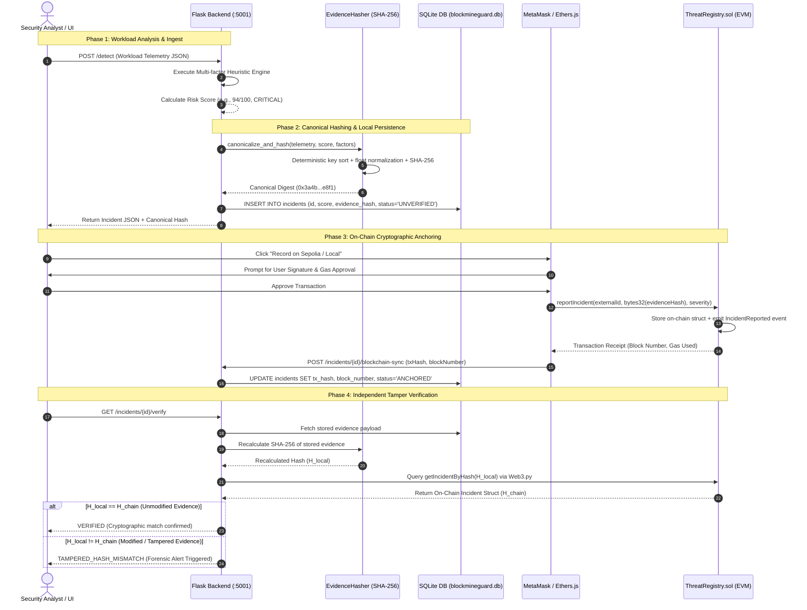

# BlockMineGuard — System Architecture Specification

**Academic Capstone & Cybersecurity Research Project**  
**Title:** Blockchain-Based Tamper-Evident Cryptojacking Detection and Threat Intelligence Sharing Framework  
**Author:** Vansh Sharma  

---

## 1. Architectural Philosophy & Core Tenets

BlockMineGuard is designed around a fundamental security engineering principle: **Separation of Operational Execution, Local Telemetry Persistence, and Decentralized Cryptographic Attestation**.

### 1.1 The Fundamental Division: SQLite Database vs. Blockchain Ledger

A common anti-pattern in early Web3 applications is attempting to store raw telemetry or transactional state directly on-chain. BlockMineGuard strictly avoids this:

| Characteristic | Local / Operational Database (SQLite) | Decentralized Smart Contract (`ThreatRegistry.sol`) |
| :--- | :--- | :--- |
| **Primary Role** | Fast, high-frequency telemetry query and storage | Immutable, tamper-evident forensic anchoring & non-repudiation |
| **Data Stored** | Complete workload metrics (CPU %, memory %, network destination, process arguments, timestamps, local resolution status) | 32-byte canonical SHA-256 evidence digest (`bytes32 evidenceHash`), external incident ID, severity enum, reporter address |
| **Privacy & Compliance** | Protects internal hostnames, user process trees, and container namespaces off-chain (GDPR & operational security) | Publicly verifiable on Ethereum Sepolia or Local EVM without leaking confidential infrastructure telemetry |
| **Latency & Cost** | Sub-millisecond indexed SQL reads (`<5ms`); zero gas overhead | Block confirmation latency (12–15s on Sepolia); gas cost incurred once per incident (~48,210 gas) |
| **Mutability** | Mutable: allows incident status updates (`RESOLVED`, `MITIGATED`, notes) | Append-only: state transitions (`reportIncident`, `verifyIncident`) emit audit events and can never be rewritten |
| **Trust Model** | Semi-trusted: vulnerable to root compromised tampering or insider alteration | Zero-trust: tamper-detection is mathematical; an adversary cannot rewrite a confirmed block without 51% attack |

---

## 2. Comprehensive System Architecture Diagram

```
+-----------------------------------------------------------------------------------------------------------------+
|                                           WORKLOAD & TELEMETRY SOURCES                                          |
|  - Synthetic Test Fixtures: sample_data/cryptojacking_workload.json, sample_data/normal_workload.json          |
|  - Real Host Probes: psutil host telemetry monitor (CPU, memory, runtime, process name)                       |
|  - Container Environments: Read-only Cgroup v2 adapter (memory.current, cpu.stat, network RX/TX)               |
+-----------------------------------------------------------------------------------------------------------------+
                                                       |
                                                       v
+-----------------------------------------------------------------------------------------------------------------+
|                                     PYTHON FLASK REST BACKEND (PORT 5001)                                      |
|                                                                                                                 |
|  +--------------------------------+   +---------------------------------+   +--------------------------------+  |
|  |     Ingest & API Gateway       |   |    Multi-Factor Heuristic Engine|   |   Canonical Evidence Hasher    |  |
|  |  - POST /detect                |   |  - Sliding-window statistics    |   |  - Deterministic JSON sorting  |  |
|  |  - GET /incidents & /stats     |   |  - CPU sustained load threshold |   |  - Exact type normalization    |  |
|  |  - POST /threat-intelligence   |   |  - Known miner process name list|   |  - SHA-256 Digest generation   |  |
|  |  - GET /evaluation/results     |   |  - Stratum mining pool matcher  |   |    (32-byte hex representation)|  |
|  +--------------------------------+   +---------------------------------+   +--------------------------------+  |
|                                                       |                                                         |
|                                                       v                                                         |
|  +-----------------------------------------------------------------------------------------------------------+  |
|  |                                SQLite Database (backend/blockmineguard.db)                                 |  |
|  |  - 3,162+ Persistent Incident Records with indexed queries                                                |  |
|  |  - Threat Intelligence IoC repository with conflict & duplicate detection                                 |  |
|  |  - Reporter reputation tracking & simulated mitigation audit logs                                         |  |
|  +-----------------------------------------------------------------------------------------------------------+  |
+-----------------------------------------------------------------------------------------------------------------+
                           |                                                         |
          Client JSON      |                                        Web3.py Read     |
          Responses        |                                        Verification     |
                           v                                                         v
+--------------------------------------+                 +--------------------------------------------------------+
|       REACT 18 SINGLE-PAGE APP       |                 |             ETHEREUM COMPATIBLE SMART CONTRACT         |
|             (PORT 3000)              |                 |                  ThreatRegistry.sol                    |
|                                      |                 |                                                        |
|  - Threat Operations Dashboard       | User-Approved   |  - Hardhat Local EVM (Chain ID: 31337, Port: 8545)     |
|  - Threat Detection Workspace        | MetaMask Signer |    Contract Address: 0x1291Be112d480055DaFd8a610b7...  |
|  - Cryptographic Verification Lab    | (Ethers.js v6)  |                                                        |
|  - Blockchain Ledger Explorer        |---------------->|  - Public Ethereum Sepolia Testnet (Chain ID: 11155111)|
|  - Research Evaluation Lab           |                 |    Public RPC: https://ethereum-sepolia-rpc...         |
|  - Theme System (Dark/Light/System)  |                 |    Explorer: https://sepolia.etherscan.io/             |
+--------------------------------------+                 +--------------------------------------------------------+
```

---

## 3. End-to-End Cryptographic Verification Sequence

The core proof of BlockMineGuard is its **Tamper-Evident Incident Life Cycle**:



---

## 4. Multi-Factor Detection Pipeline

The detection pipeline in `backend/detector/detection_engine.py` implements transparent, explainable heuristic scoring:

### 4.1 Scoring Formula

The total risk score $R \in [0, 100]$ is computed as the bounded sum of four orthogonal telemetry factors:

$$R = \min\left(100, S_{\text{CPU}} + S_{\text{Process}} + S_{\text{Network}} + S_{\text{Memory}}\right)$$

Where:
1. **CPU Sustained Intensity Factor ($S_{\text{CPU}} \in [0, 50]$)**:
   - Evaluates sustained processor utilization.
   - $\text{CPU} \ge 90\% \implies +50$ points.
   - $70\% \le \text{CPU} < 90\% \implies +35$ points.
   - $50\% \le \text{CPU} < 70\% \implies +20$ points.
   - $\text{CPU} < 50\% \implies 0$ points.

2. **Process Identity & Signature Matching ($S_{\text{Process}} \in [0, 30]$)**:
   - Checks against known miner signatures (`xmrig`, `cpuminer`, `ethminer`, `minerd`, `kinsing`, `kdevtmpfsi`).
   - Exact signature match $\implies +30$ points.
   - Benign compiler or database process dampening reduces score to prevent developer workstation false positives.

3. **Stratum Mining Pool & Network Indicators ($S_{\text{Network}} \in [0, 20]$)**:
   - Evaluates outbound connections against standard mining ports (`3333`, `4444`, `5555`, `14444`, `3380`) and known mining pool domains (`supportxmr`, `ethermine`, `minexmr`, `nanopool`, `nicehash`).
   - Mining pool destination detected $\implies +20$ points.

4. **Memory Footprint Profile ($S_{\text{Memory}} \in [0, 10]$)**:
   - High memory combined with long process runtime ($>3600\text{s}$) $\implies +10$ points.

### 4.2 Severity Classification Thresholds

| Severity Level | Score Range | Operational Response Protocol |
| :--- | :--- | :--- |
| **CRITICAL** | $80 \le R \le 100$ | Automated on-chain anchoring recommendation; immediate simulated process suspension (`SIGSTOP`). |
| **HIGH** | $60 \le R < 80$ | High-priority security triage; simulated cgroup CPU quota throttling (capped at 10%). |
| **MEDIUM** | $35 \le R < 60$ | Forensic telemetry logging; elevated eBPF event capture. |
| **LOW** | $0 \le R < 35$ | Benign workload baseline observation; no containment action required. |

---

## 5. Smart Contract Design: `ThreatRegistry.sol`

The smart contract is written in **Solidity 0.8.24** and deployed to both Localhost Hardhat (`31337`) and Ethereum Sepolia (`11155111`).

### 5.1 Public Interface & Access Controls

```solidity
// Core State Structures
struct Incident {
    uint256 incidentId;
    string externalId;           // e.g. "INC-2026-001"
    bytes32 evidenceHash;        // SHA-256 canonical digest
    uint256 timestamp;           // Block timestamp
    uint8 severity;              // 0=LOW, 1=MEDIUM, 2=HIGH, 3=CRITICAL
    address reporter;            // Signer address
    uint8 verificationStatus;    // 0=UNVERIFIED, 1=VERIFIED, 2=TAMPERED
    uint8 resolutionStatus;      // 0=OPEN, 1=INVESTIGATING, 2=RESOLVED
    string threatIntelRef;       // Optional IoC pointer
    bool exists;
}
```

### 5.2 Sybil-Resistant Reputation System
- Reporters gain **+5 reputation** when their reported incidents or threat intelligence items are independently verified by authorized peers.
- Submitting false reports or disputed indicators incurs a **-15 reputation** penalty (floored at 0).
- Duplicate evidence hashes are rejected on-chain with `DuplicateEvidenceHash()` revert, preventing replay attacks.

---

## 6. Frontend Architecture & Design System

The frontend is a single-page React 18 application styled with custom CSS variables and zero external UI template bloat:
- **Ethers.js v6 Integration**: Injected MetaMask provider handles user-approved signatures for `reportIncident()` and network switching.
- **Dynamic Dual-Network Detection**: Automatically differentiates Hardhat Local (31337) and Sepolia (11155111) with non-blocking UI warnings if the user connects to an unsupported chain.
- **Theme Engine**: Centralized CSS tokens for `#0B0F14` Dark Mode and `#F6F8FA` Light Mode with zero runtime lag and automatic persistence in `localStorage`.
